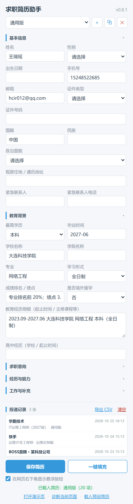
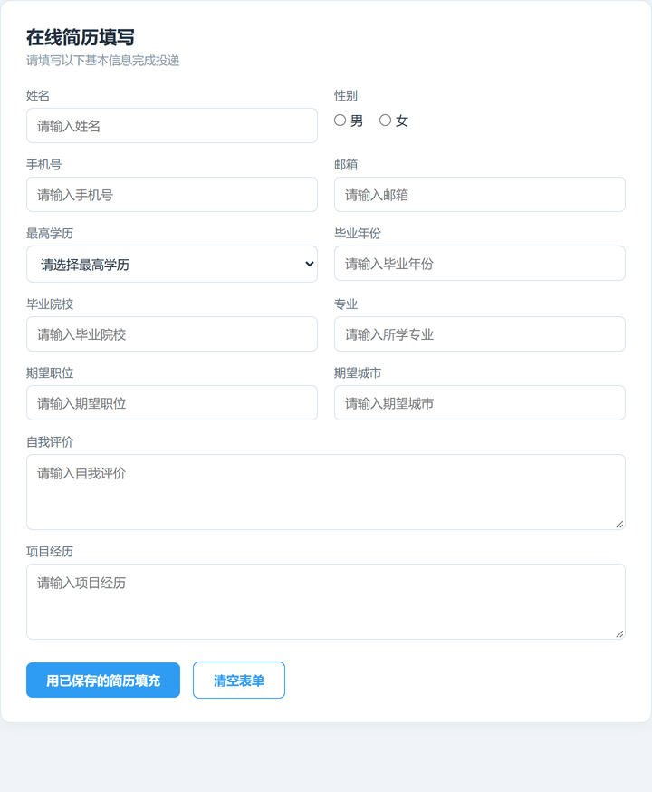
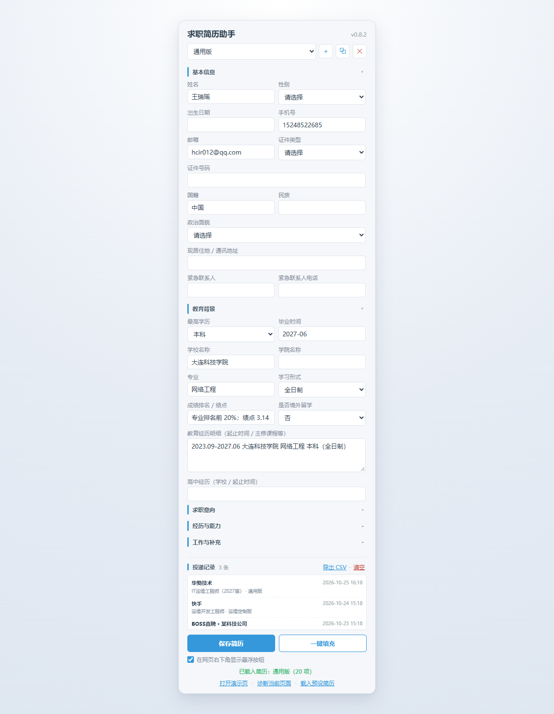
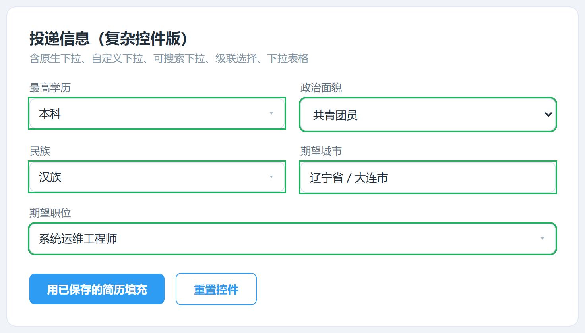
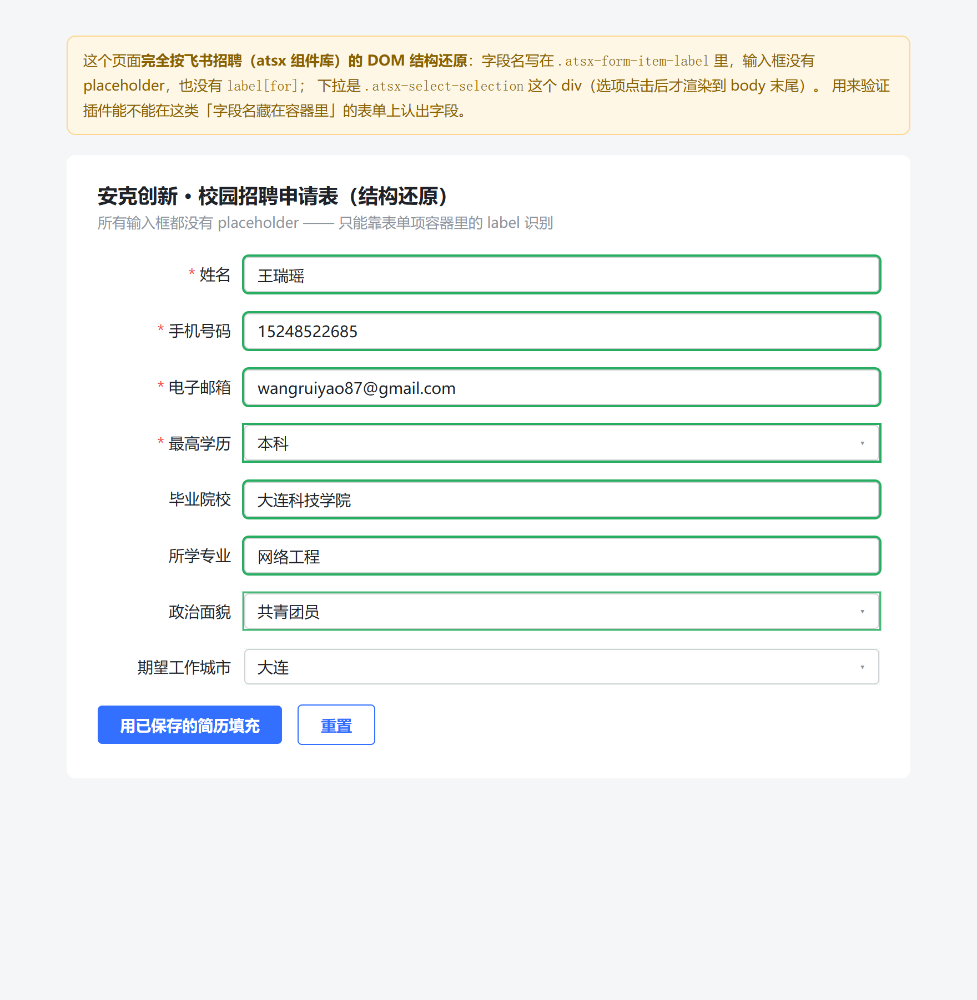
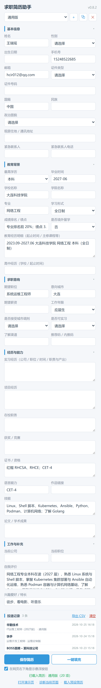

# 求职简历助手（job-helper-extension）

一款求职效率 Chrome 插件：简历 PDF 一键导入成 44 项结构化字段、中文简历一键填充网申表单、多简历版本管理、投递记录台账与 CSV 导出。数据默认只存浏览器本地（`chrome.storage.local`）；唯一的外呼是「PDF 导入」时向你**自己配置**的模型服务发一次请求。

> 技术栈：Chrome Extension Manifest V3 · 原生 HTML/CSS/JS · chrome.storage.local · pdf.js（本地内置）· OpenAI 兼容大模型接口

**下载即用**：[最新版本 v0.11.0](https://github.com/Hcir782/job-helper-extension/releases/latest) · 解压后加载即可，不需要 Node / npm / 构建步骤 · [全部版本](https://github.com/Hcir782/job-helper-extension/releases)

| 插件面板（44 字段 / 版本管理 / 投递记录） | 一键填充真实表单 |
| --- | --- |
|  |  |

<p align="center"><sub>右图为插件自带演示页的实际填充过程：绿色描边为命中字段，底部提示本次填充结果</sub></p>


## 功能规划

| 功能 | 状态 |
| --- | --- |
| 插件基础骨架（Manifest V3 + Popup + Content Script） | ✅ 已完成 |
| 简历信息本地存储 + 招聘网页一键填充 | ✅ 已完成（v0.2.0） |
| 模拟招聘表单演示页 + 页面结构诊断 | ✅ 已完成 |
| 动态注入（activeTab + chrome.scripting，任意网站可用） | ✅ 已完成（v0.3.0） |
| 字段别名词典 + 站点/组件库适配器 | ✅ 已完成（v0.3.0） |
| 全网页自动注入 + 悬浮按钮可开关 | ✅ 已完成（v0.4.0） |
| 多简历版本管理（新建 / 切换 / 复制 / 删除） | ✅ 已完成（v0.5.0） |
| 投递记录台账（公司 / 岗位 / 时间 / 简历版本） | ✅ 已完成（v0.6.0） |
| 投递记录导出 CSV（Excel 可直接打开） | ✅ 已完成（v0.6.0） |
| 内置预设简历一键载入（换设备/答辩演示快速就绪） | ✅ 已完成（v0.7.0） |
| 表单字段扩展到 44 项（Moka 华勤 + 快手申请表字段并集去重） | ✅ 已完成（v0.8.0） |
| 表单去掉灰色占位示例文字，空字段保持空白 | ✅ 已完成（v0.8.1） |
| 标签页模式下面板居中显示为卡片（不再贴左上角） | ✅ 已完成（v0.8.2） |
| 自定义下拉 / 可搜索下拉 / 级联选择 / **下拉表格** 填充 | ✅ 已完成（v0.9.0） |
| **原生日期控件**（date / month）与**年月分离双下拉**填充 | ✅ 已完成（v0.10.0） |
| 下拉较多时不再跳过靠后的控件（单控件 1.8s / 总预算 12s） | ✅ 已完成（v0.10.0） |
| 飞书招聘（`*.jobs.feishu.cn`，atsx 组件库）表单适配 | ✅ 已完成（v0.10.1） |
| 多框架页面（主文档表单 + 客服/埋点 iframe）自动挑对那一帧 | ✅ 已完成（v0.10.2） |
| **简历 PDF 导入**：上传 PDF → 本地抽文字 → 大模型映射成 44 字段 | ✅ 已完成（v0.11.0） |

## 简历 PDF 导入（v0.11.0）

手敲 44 个字段太累，现在可以直接喂一份简历 PDF：

1. 面板顶部展开「从简历文件导入（PDF）」
2. 填模型服务地址 / 模型名 / API Key，点「测试连接」确认能通
3. 把 PDF 拖进虚线框（单份 ≤ 8 MB）
4. 核对抽出的字段（只显示有值的项，缺失项的条数会列出来）
5. 点「导入为新简历版本」——**总是新建版本，不会覆盖你现有的简历**

**隐私边界**：PDF 文件留在本地，用内置 pdf.js 抽文字；只有抽出的文本会发给你自己配置的模型服务。勾上「只记住本次会话」后 API Key 存 `chrome.storage.session`，关掉浏览器即清空。

**支持的模型服务**：任何 OpenAI 兼容接口。

| 服务 | 地址 | 模型名 |
| --- | --- | --- |
| DeepSeek | `https://api.deepseek.com/v1` | `deepseek-chat` |
| 通义千问 | `https://dashscope.aliyuncs.com/compatible-mode/v1` | `qwen-plus` |
| 智谱 | `https://open.bigmodel.cn/api/paas/v4` | `glm-4-flash` |
| Moonshot | `https://api.moonshot.cn/v1` | `moonshot-v1-8k` |
| 本地 Ollama | `http://localhost:11434/v1` | `qwen2.5:7b` |

> 扫描件 PDF（拍照片转的）没有文字层，抽不出字，会明确提示「请导出带文字层的 PDF」。

### 它是怎么把 PDF 变成 44 个字段的

整条链路四层，每层都可单测，都在 `lib/` 下：

| 层 | 文件 | 做什么 | 关键决策 |
| --- | --- | --- | --- |
| 取文本 | `pdf-text.js` | 用本地 pdf.js 按页取文本块，**按坐标还原行** | 不转 Markdown：两栏简历会被挤成一行，姓名和电话糊在一起。按 y 分组、组内按 x 排序，才保得住版面 |
| 调模型 | `llm-client.js` | OpenAI 兼容 `/chat/completions`，超时 + 指数退避 + 错误分类 | 请求由 background 代发：弹窗失焦会销毁、直连第三方 API 会撞 CORS 预检 |
| 校验 | `resume-schema.js` | 44 字段 JSON Schema + 确定性清洗 | 枚举收敛、日期/手机/邮箱规范化都在这里；能确定性修的就不花第二次请求 |
| 编排 | `resume-extract.js` | 分块 → 抽取 → 校验 → **只对不合格字段定向修补** | 不让模型重写整份；修补只接受那一个字段的新值 |

**结构化输出三级降级**：

```
json_schema（服务端强约束，最可靠）
   ↓ HTTP 400/422「参数不支持」
json_object（只保证是合法 JSON）
   ↓ 还是 400/422
prompt_only（靠 system prompt 里的字段清单约束，兼容本地小模型）
```

鉴权错误（401/403）和网络错误**不降档**——换档位也不可能成功，直接把原因和「该去改哪里」告诉用户。

**为什么要有确定性校验**：模型会写「学士」「硕士研究生」「本科（全日制）」「2027年6月」「152-4852-2685」。这些值在网申表单的下拉框里**一个都选不中**。所以抽取完还要过一遍：

- `学士/大学本科 → 本科`、`硕士研究生 → 硕士`、`统招 → 全日制`
- `2027年6月 / 2027.6 / 2027/06/30 → 2027-06`
- `152-4852-2685 → 15248522685`
- `WangRuiYao87@Gmail.com → wangruiyao87@gmail.com`
- 模型自造的字段（`wechat`、`微信号`）直接丢弃并记账

**一处刻意的「不做」**：不根据「2026.10 - 至今」推算「1 年工作经验」。抽取只搬运简历上写了的字，任何推算都可能变成面试时说不清的数字。

## 支持的招聘网站

**所有网页**。v0.4.0 起 `content_scripts.matches` 与 `host_permissions` 均使用 `<all_urls>`，任意网页打开即注入，右下角出现悬浮按钮。

内置了针对性适配器的站点：

| 类型 | 覆盖 |
| --- | --- |
| 站点适配 | BOSS直聘、猎聘、智联招聘、前程无忧、拉勾、飞书招聘（`*.jobs.feishu.cn`） |
| 组件库适配（企业自建招聘系统常用） | 飞书 atsx、Ant Design、Element UI、Arco Design |

未命中任何适配器时，会退回通用启发式规则（label / placeholder / aria-label / 邻近文本 / **表单项容器内的 `*label` 元素**）。

> 如果不想让悬浮按钮出现在每个网页，打开面板取消勾选「在网页右下角显示悬浮按钮」即可，已打开的页面会实时隐藏。

## 快速开始（拿到仓库后 3 分钟）

不需要 Node、不需要 `npm install`、不需要构建——这就是一堆可以直接被浏览器加载的静态文件。只有想跑测试时才需要 Node。

### 1. 拿到代码

| 方式 | 操作 | 适合 |
| --- | --- | --- |
| **下载 Release 包（最省事）** | 打开 [最新版本](https://github.com/Hcir782/job-helper-extension/releases/latest)，下载 `job-helper-extension-vX.Y.Z.zip` 并解压 | 只想用插件，不关心 git |
| 下载 ZIP（源码） | 仓库页右上角 **Code → Download ZIP**，解压到任意目录 | 只用插件、不改代码 |
| git clone | `git clone https://github.com/Hcir782/job-helper-extension.git` | 想跟进后续更新、改代码 |

> ⚠️ 解压后文件夹名可能是 `job-helper-extension-main`，这没关系，**只要这一层里有 `manifest.json` 就对**。

### 2. 加载到浏览器

1. Chrome 打开 `chrome://extensions/`，Edge 打开 `edge://extensions/`
2. 打开右上角 **开发者模式**（Developer mode）
3. 点 **加载已解压的扩展程序 / Load unpacked**
4. **选中第 1 步解压出来的那一层文件夹**（含 `manifest.json` 的目录）——不要选里面的 `tests/`、`docs/` 等子目录，也不要选中单个文件
5. 工具栏出现图标即成功，建议点图钉固定到工具栏（快捷键是 `Ctrl + Shift + Y`）

安装时浏览器会提示「读取和更改所有网站数据」，这是 `<all_urls>` 注入悬浮按钮所必需的，插件不会上传任何数据。

### 3. 首次使用

刚装好的面板是**空的**（不会带任何人的数据）。两条路：

- 自己填：打开面板逐项填写 → **保存简历**；
- 想快速看效果：点面板底部 **载入预设简历**，会导入一份示例版本（作者本人的校招信息，含华勤/快手的申请字段），看完在版本下拉框切回「通用版」或把示例版本删掉即可。

填完简历后，**打开招聘网站的职位/申请页并刷新一次**，再点面板的 **一键填充**。想先就地验证，点 **打开演示页** 或直接打开 `demo-widgets.html`。

### 4. 更新到最新版

- ZIP 安装的：重新下载 ZIP 覆盖原文件夹（或解压到新目录后重新加载）
- clone 的：在仓库目录执行 `git pull`
- 然后到 `chrome://extensions/` 点插件卡片上的 **刷新 ↻**，再刷新已打开的网页

面板右上角显示的版本号（如 `v0.11.0`）就是当前生效版本，对不上说明没刷新成功。

### 5. 卸载 / 清空数据

扩展页点 **移除** 即可彻底删除，简历与投递记录都存在扩展自己的 `chrome.storage.local` 里，卸载即消失，不会残留在网页或云端。

### 装不上时的排查

| 现象 | 原因 | 解决 |
| --- | --- | --- |
| 提示「清单文件缺失或不可读取」 | 选错了目录层级 | 重选，确保那一层能直接看到 `manifest.json` |
| 加载成功但网页上没有红色 `fill` 按钮 | 页面是安装前就打开的 | 刷新页面；还不行就在扩展页点 ↻ 后重启浏览器 |
| 点填充提示「页面未响应」 | content script 未注入（旧标签页/受限页面） | 刷新页面；`chrome://` 开头的系统页无法注入，属正常 |
| 版本号一直是旧版 | 改了代码但没重载扩展 | `chrome://extensions/` 点插件卡片的刷新按钮 |

## 使用教程

### 三种打开面板的方式

| 方式 | 操作 |
| --- | --- |
| 工具栏图标 | 点击插件图标（需先钉到工具栏） |
| 快捷键 | `Ctrl + Shift + Y` |
| 页面悬浮按钮 | 招聘页右下角红色圆形 `fill` 按钮 |

前两种是浏览器弹窗，尺寸紧凑；后一种会在新标签页里打开面板，此时面板居中显示为一张卡片（v0.8.2 起），整页自然滚动，字段看得更全：



### 一键填充

1. 点击插件图标打开面板，填写姓名、手机号、学历、毕业院校、期望职位等字段
2. 点击 **保存简历**，数据存入浏览器本地
3. 打开招聘网站的简历填写页或申请表单页，刷新一次页面
4. 回到面板点击 **一键填充**，页面中匹配到的输入框会以绿色描边闪一下
5. 面板底部提示本次填充结果，例如「已填充 8 个字段，3 个未匹配」

### 演示页

面板底部点击 **打开演示页**，会打开插件自带的模拟招聘申请表，用于验证填充引擎是否正常，不依赖任何真实网站，也不受网站改版影响。

### 页面诊断

在招聘页面点击面板底部 **诊断当前页面**，会列出页面上的候选控件（类型、周边文案、name/id）。字段匹配异常时用它定位原因。诊断结果里出现「**自定义下拉**」条目，说明插件认出了这类控件；如果填不上，通常是选项文案对不上（见下一节）。

### 下拉表格 / 自定义下拉（v0.9.0）

很多校招系统（Moka、快手自建、企业自研后台）的下拉**不是**原生 `<select>`：页面上是一个 `div`，点开后才把选项渲染到 `body` 末尾的浮层里，有的还是**表格**（一行一个岗位、一行一个部门），选完要再点「确定」。这类控件以前只能算「未匹配」，现在插件会**模拟真实点击**去填：

| 形态 | 典型长相 | 插件怎么填 |
| --- | --- | --- |
| 普通自定义下拉 | Ant Design `Select`、Element `Select` | 点开 → 在浮层里按文案找选项 → 点中 |
| 可搜索下拉 | 触发器本身是个搜索框（如「民族」） | 先按文案找；找不到就把值打进搜索框，等组件自己过滤后再选一次 |
| 级联选择 | 省 → 市、部门 → 小组 | 值按 `/`、`>`、`、` 或连续空格拆段，逐级点下去（如「辽宁省 / 大连市」） |
| **下拉表格** | 浮层里是 `<table>`，一行一个选项，底部有「确定」 | 按文案找到对应 `<tr>` → 点行内 radio/整行 → 点「确定」 |

匹配规则（`lib/option-match.js`）：

- 忽略空格（含全角空格）、忽略括号补充说明、不区分大小写：「CET-4（520 分）」能匹配选项「CET-4」
- 原文完全相同 > 去括号后相同 > 选项包含值（「本科（全日制）」←「本科」）> 值包含选项（「RHCSA、RHCE；CET-4」→「RHCE」）
  - 前两档必须分开，否则「CET-6」与「CET-6（520 分）」并列同分，会被判成歧义而不填
- **歧义宁可不动**：一个值同时像多个选项时（比如证书字段同时含 RHCSA 和 RHCE），不替用户瞎选，留空让他手动点
- 每个控件独立超时 1.8 秒，全部自定义控件共享 12 秒总预算；超时或选不中都会单独记账，面板会点名告诉你哪几个该手动点

### 日期类控件（v0.10.0）

| 形态 | 简历里的值 | 插件怎么写 |
| --- | --- | --- |
| `<input type="month">` | `2027-06`（或「2027年6月」） | 归一化成 `2027-06` |
| `<input type="date">` | `2005-08` | 只有年月时按当月 1 日补：`2005-08-01` |
| `<input type="datetime-local">` | `2027-06-15 14:30` | 补成 `2027-06-15T14:30` |
| **年月分离的两个下拉** | `2005-08` | 先判断谁是「年」谁是「月」，配成一对，再拆成 `2005` / `08` 分别选 |

「年月分离」的配对用的是 `lib/date-group.js`：有选项就读选项（年份列表 / 1-12 月份列表），读不到（伪下拉要展开才有）就看「年」「月」占位文案；**只有在同一容器内、彼此相邻、且一个年一个月时才配对**——配错会把 `08` 写进年份框，比不填更糟。

想自己验证：打开 `demo-widgets.html`（模拟 Ant Design 下拉、可搜索下拉、省级联、职位下拉表格，外加 `<input type="month">` 与一组年月分离下拉），点「用已保存的简历填充」，六类控件应全部填上。



<sub>上图为实测：原生下拉「共青团员」、自定义下拉「本科」、可搜索下拉「汉族」、省级联「辽宁省 / 大连市」、职位下拉表格「系统运维工程师」一次填完，绿色描边为命中提示。</sub>

### 飞书招聘表单（v0.10.1）

飞书招聘（`<公司>.jobs.feishu.cn`，例如 `anker-in.jobs.feishu.cn`）用的是字节自研的 **atsx** 组件库，DOM 结构和别的站点都不一样：

| 难点 | 具体表现 | 插件怎么处理 |
| --- | --- | --- |
| 输入框没有 `placeholder` | `<input>` 上没有任何提示文案 | 从表单项容器里取 |
| 字段名不是 `<label for>` | 也不是 `.ant-form-item-label` 那种标准结构 | 适配器读 `.atsx-form-item-label` |
| 祖先链前几层全是噪音 | `input → form-item-children → form-item-control → col → form-item`，中间几层文字只有「+86」「获取验证码」 | 标签查找走上限 6 层，只认类名像 `*label` 的元素，且必须是**排在控件之前**、文字 ≤24 字 |
| 下拉是 div 不是 `<select>` | `.atsx-select-selection`（带 `role="combobox"`），选项点开后才渲染到 body 末尾 | 走伪下拉流程：模拟手势 → 等 `.atsx-select-dropdown` → 按文案点 `li` |
| 浮层层级套娃 | `.atsx-select-dropdown` 里还套着 `ul.atsx-select-dropdown-menu` 和 `li…-menu-item`，三者都命中宽松选择器 `[class*='-dropdown']` | 浮层只保留最外层，否则会在某个 `<li>` 里找选项，永远选不中 |

适配器之外还有一层**通用兜底**：只要某个站点把字段名放在「类名像 form-item 的容器 + 类名像 label 的元素」里，即使没有专属适配器也能认出来。

想自己验证：打开 `demo-feishu.html`（完全按 atsx 结构还原，输入框无 placeholder，下拉是 div），点「用已保存的简历填充」，5 个输入框 + 3 个下拉应全部填上。



<sub>上图为实测：字段名只存在于 `.atsx-form-item-label` 里、输入框没有任何 placeholder 的情况下，5 个输入框与 3 个 atsx 下拉仍全部命中（绿色描边为命中提示）。</sub>

### 页面里有 iframe（v0.10.2）

很多招聘页会在右下角挂一个客服/埋点 iframe，甚至把表单本身也塞进 iframe。这里有一个**容易踩的坑**：

> `chrome.tabs.sendMessage(tabId, msg)` 不带 `frameId` 时会把消息**广播给所有框架**，但回调只拿到**最先回话的那一个**。

京东校招简历页（`campus.jd.com/api/wx/position/index#/resume`）就是这样：客服 iframe（`salary-collect-pro.pf.jd.com`）里只有一个「向我提问」输入框，它抢在主文档前面回话，于是面板显示「iframe 内 扫描到 文本框 1」，真正的表单一个字段都没被处理。

现在的做法：

| 步骤 | 做什么 | 为什么 |
| --- | --- | --- |
| ① 枚举框架 | `chrome.scripting.executeScript({ allFrames: true })` 拿到所有 frameId | 不枚举就只能瞎猜 |
| ② 按帧补注入 | 只给 `PING` 没回应的那一帧注入内容脚本 | 全量重注会多挂一个消息监听，一次填充被执行两遍 |
| ③ 逐帧体检 | 每帧跑一次只读的 `DIAGNOSE`，按控件数量打分（伪下拉/富文本权重更高） | 客服 iframe 通常只有 1 个输入框，真表单动辄十几个 |
| ④ 只填最像的那帧 | 从高分往低分试，**第一个真填上东西的就收工**；只试「不低于最高分一半」的帧，最多 3 帧 | 不能在广告 iframe 上白等 12 秒伪下拉预算 |
| ⑤ 失败时合并统计 | 一帧都没填上就把全页控件数求和，并在诊断里标注每个条目的来源框架 | 否则用户只看到某个 iframe 的 1 个输入框，完全看不懂 |

想自己验证：`node tests/e2e-frames.js` —— 它会加载真实扩展、起一个本地 http 服务打开 `demo-frames.html`（主文档是简历表单，右下角客服 iframe 只有一个输入框），然后断言「表单填上、客服输入框一个字符都没被写、诊断里两个框架都标了来源」。

### 多简历版本管理

面板顶部的版本工具栏可以管理多份简历：

| 操作 | 说明 |
| --- | --- |
| 切换版本 | 下拉框选择，切换时如有未保存修改会弹窗询问是否保存 |
| 新建版本（＋） | 创建一份空白简历，适合「通用版 / 运维定制版 / 前端定制版」分场景投递 |
| 复制版本（⧉） | 把当前版本复制一份再改，不用从零填写 |
| 删除版本（✕） | 删除当前版本，自动切换到剩余版本；至少保留一个 |

保存和一键填充始终作用于**当前选中的版本**。

### 投递记录与 CSV 导出

- 打开内置适配的招聘站点（BOSS直聘 / 猎聘 / 智联 / 前程无忧 / 拉勾）职位页时，插件自动从页面标题提取**公司 + 岗位**登记到台账；在页面执行过一次一键填充也会登记。
- 每条记录包含：公司、岗位、投递时间、当时使用的简历版本、页面链接。
- **自动去重**：同公司 + 同岗位 + 同一天只记一条，反复刷新页面不会刷屏。
- 面板底部「投递记录」区展示最近 50 条，点 **导出 CSV** 可下载完整台账（带 BOM，Excel 直接打开中文不乱码），点 **清空** 可全部删除。

### 载入预设简历

面板底部点击 **载入预设简历**，会把 `presets/resume-wangruiyao.json` 里预置的完整简历导入为一个**新版本**（不覆盖已有数据），并自动切换到该版本。

用途：
- 换电脑、换浏览器后快速恢复一份可用数据，不用从零手动填写
- 答辩/演示时一键准备完整数据，避免现场打字

预设文件是普通 JSON，可以按同样格式放自己的版本，文件名需要在 `popup.js` 的 `loadPresetResume()` 里对应修改。空字段会保持为空，不会瞎填。

### 答辩 / 汇报演示流程（约 5 分钟）

按下面的顺序演示，全程不依赖外网，也不怕招聘网站改版：

| 步骤 | 操作 | 讲解要点 |
| --- | --- | --- |
| 0 · 准备 | `chrome://extensions/` 加载插件 → 打开面板 → 点 **载入预设简历** | 数据一键就绪，不用现场打字 |
| 1 · 版本管理 | 面板顶部下拉框切换 / 点 ＋ 新建 / ⧉ 复制 | 一份简历按岗位分版本投递，切换时提示保存 |
| 2 · 一键填充 | 点 **打开演示页** → 在演示页点「用已保存的简历填充」 | 命中字段绿色描边，底部输出「已填充 N 个字段」 |
| 2.5 · 复杂控件 | 打开 `demo-widgets.html` → 点「用已保存的简历填充」 | 普通下拉 / 可搜索下拉 / 省级联 / **下拉表格** 四种形态一次填完，体现「模拟点击 + 选项匹配」 |
| 3 · 真实网页 | 打开任意招聘职位页，右下角红色 `fill` 按钮 | 悬浮入口 + 全网页注入（`<all_urls>`） |
| 4 · 投递记录 | 回到面板看「投递记录」→ 点 **导出 CSV** | 自动登记公司/岗位/版本，CSV 带 BOM，Excel 直接打开 |
| 5 · 技术要点 | 讲「动态注入 / 别名词典 / React 受控组件适配 / 伪下拉模拟点击 / 单一数据源」 | 见下方「技术要点」章节 |

### 常见问题（FAQ）

**Q：点了网页右下角的 `fill` 悬浮按钮没反应？**
A：先刷新页面。仍不行说明 content script 是旧版本，在 `chrome://extensions/` 点插件的刷新按钮，然后重新加载网页。若 background 正在休眠，v0.6.1 起会自动降级为新标签页直接打开面板。

**Q：填充后提示「N 个字段未匹配」怎么办？**
A：先看提示的后半句——v0.10.0 起会区分两种情况：
- **「其中 X 个下拉没选上：外语水平、民族…」**：控件认出来了，但选项文案和简历里的值对不上，或者同时像好几个选项（插件宁可不填）。改简历里的写法最省事，比如把「CET6」写成「CET-6」。
- **「N 个未匹配」**：页面上真没找到对应输入框。点面板底部 **诊断当前页面** 看页面上到底有哪些控件；如果该字段是**日历弹层**，说明是目前还没支持的形态；如果连条目都没有，多半是渲染在 Shadow DOM / 跨域 iframe 里，插件读不到。

**Q：日期、年月填不上怎么办？**
A：v0.10.0 起已支持原生 `<input type="date|month">` 和「年 + 月」两个下拉的组合填写。仍填不上通常是两种情况：① 控件是**日历弹层**（点开是一整个月历），尚未支持；② 两个「年」「月」下拉之间隔着别的控件，或者不能确定谁是年谁是月，插件会主动放弃以免填错——这种手动点两下最快。

**Q：下拉表格（点开是一张表格的选项）能填吗？**
A：能（v0.9.0）。插件会模拟点击打开浮层，按文案在表格里找到对应行、点中行的单选按钮，再点「确定」。想验证就用 `demo-widgets.html`。注意：选完之后如果页面还要「保存草稿」才生效，那一步仍需手动点。

**Q：数据存在哪里？换电脑怎么迁移？**
A：全部存在浏览器本地的 `chrome.storage.local`，不联网、不上传。迁移时把 `presets/resume-wangruiyao.json` 按同样格式改好，在新环境点 **载入预设简历** 即可；也可用投递记录里的 **导出 CSV** 备份台账。

**Q：PDF 导入抽出来的字段有错怎么办？**
A：先在预览列表里看——**对的结果不会自动进表**，要你点「导入为新简历版本」才写入。如果错得离谱（比如姓名变成公司名），通常是 PDF 是两栏排版被读串行了，可以换一份导出格式再试。如果只是个别字段不对，直接导入后在面板里改最快——面板本来就是可编辑的。

**Q：导入的 PDF 会被上传到你们服务器吗？**
A：没有「我们的服务器」。PDF 在你浏览器里用内置 pdf.js 抽成文字，然后**直接**发给你自己填的那个模型服务地址（比如 DeepSeek）。插件里没有中转、没有埋点。介意的话可以用本地 Ollama：地址填 `http://localhost:11434/v1`，全程不出本机。

**Q：模型返回的 JSON 总是格式不对？**
A：插件已经做了三级降级（`json_schema` → `json_object` → 靠 prompt 约束）。如果你在面板提示里看到「已自动降级」，说明这个服务的结构化输出能力较弱，**换一个模型**通常比调参数有效。7B 以下的本地小模型做 44 字段抽取比较吃力，建议至少 14B，或直接用云端的 `deepseek-chat`。降级本身不会导致失败，只会让字段完整度下降。

**Q：为什么安装时提示「读取和更改所有网站数据」？**
A：因为要在所有网页提供悬浮入口和按需注入（`<all_urls>`）。插件不发起任何数据上传，唯一的网络请求是读取本地 `presets` 文件。

**Q：保存了简历但填充还是旧内容？**
A：填充始终作用于**当前选中的版本**。确认下拉框里选的是你要投的那一版；另外页面需要刷新一次才能拿到最新注入的脚本。

### 字段清单（44 项，5 组可折叠）



面板表单字段是把两个真实校招申请表的字段做**并集去重**得到的：

- 华勤技术（Moka ATS）：`app.mokahr.com/campus-recruitment/hq/*`
- 快手校招：`campus.kuaishou.cn/recruit/campus/e/`

| 分组 | 字段 |
| --- | --- |
| 基本信息（13） | 姓名、性别、出生日期、手机号、邮箱、证件类型、证件号码、国籍、民族、政治面貌、现居住地/通讯地址、紧急联系人、紧急联系人电话 |
| 教育背景（10） | 最高学历、毕业时间、学校名称、学院名称、专业、学习形式、成绩排名/绩点、是否境外留学、教育经历明细、高中经历 |
| 求职意向（8） | 期望职位、意向城市、期望薪资、工作年限、是否接受城市调剂、是否可实习、了解渠道、推荐码/内推码 |
| 经历与能力（9） | 实习经历、项目经历、在校职务、获奖/竞赛、证书/资格、语言能力、作品链接、技能、论文/学术成果 |
| 工作与补充（4） | 当前公司、当前职位、自我评价、兴趣爱好/特长 |

**合并规则**（重复字段只保留一个）：

| 两个表单里的叫法 | 合并后字段 |
| --- | --- |
| 现居住地 / 现在居住城市 / 通讯地址 | `address` |
| 意向工作城市 / 意向地点 | `expectCity` |
| 自我描述 / 自我评价 | `selfIntro` |
| 就读时间（起止） | 并入 `eduDetail` |
| 获奖经历 / 竞赛获奖 / 荣誉 | `awards` |
| 技能证书 / 证书种类 / 证书名称 | `certificates` |
| 上传简历（附件） | 不做字段——插件不处理文件上传 |

列表型经历（教育 / 实习 / 项目 / 获奖 / 在校职务 / 证书）用**一个多行文本框**承载整段文字，填充时整体写入对应的输入框或富文本编辑器。

字段定义是**单一数据源**：`field-dictionary.js` 的 `JH_FIELD_GROUPS`，面板表单、别名词典、预设 JSON 三处都从它派生；`tests/integration-smoke.test.js` 会断言 `popup.html` 的控件与词典字段**数量和顺序完全一致**，防止以后增删字段时漏改。

## 目录结构

```
job-helper-extension/
├─ manifest.json         # Manifest V3 配置：权限、popup、options、background、content script 注入规则
├─ background.js         # Service Worker：面板标签管理、按需动态注入、请求转发、投递记录写入
├─ field-dictionary.js   # 字段别名词典 + 字段分组（44 字段 × 多别名，全项目单一数据源）
├─ site-adapters.js      # 站点 / 组件库适配器注册表 + 招聘站点域名表 + 页面公司/岗位探测
├─ content.js            # 注入网页：字段识别、表单填充、注入徽标、悬浮入口、页面诊断、投递登记
├─ popup.html            # 面板（5 组可折叠表单，同时注册为"扩展程序选项"）
├─ popup.js              # 面板交互：简历版本管理、简历读写、一键填充、投递记录、CSV 导出、预设载入
├─ popup.css             # 面板与表单样式
├─ lib/ledger.js         # 投递记录台账核心逻辑（去重 / CSV / 格式化），三端共享的纯函数库
├─ lib/option-match.js   # 下拉选项匹配纯函数（归一化 / 打分 / 选优 / 拆级联 / 选表格行），content + Node 单测共用
├─ lib/date-value.js     # 日期字段归一化纯函数（2027年6月 → 2027-06 → 控件要的格式）
├─ lib/date-group.js     # 年月分离控件配对纯函数（判断谁是「年」谁是「月」并配成一对）
├─ lib/llm-client.js     # 大模型调用层：OpenAI 兼容协议、结构化输出三级降级、重试与错误翻译
├─ lib/resume-schema.js  # 44 字段契约：JSON Schema、枚举收敛、手机/邮箱/日期归一化、定向修补 prompt
├─ lib/resume-extract.js # 抽取编排：拼 prompt → 调模型 → 校验 → 只对坏字段定向修补 → 分块合并
├─ lib/pdf-text.js       # PDF 文字层抽取纯函数（按坐标还原行序、扫描件识别、分块）
├─ lib/pdfjs-boot.js     # 以 ESM 方式加载内置 pdf.js 并挂到 window.pdfjsLib
├─ vendor/
│  ├─ pdf.min.mjs        # pdf.js 主库（MV3 禁止远程加载脚本，必须内置）
│  └─ pdf.worker.min.mjs # pdf.js worker
├─ presets/
│  └─ resume-wangruiyao.json  # 内置预设简历（44 字段 + 来源信息）
├─ demo.html             # 模拟招聘申请表演示页（原生控件）
├─ demo.js               # 演示页逻辑，复用同一套填充引擎
├─ demo-widgets.html     # 复杂控件演示页（Ant 下拉 / 可搜索下拉 / 省级联 / 职位下拉表格）
├─ demo-widgets.js       # 复杂控件演示页的假组件实现（浮层渲染到 body 末尾，贴近真实框架）
├─ demo-feishu.html      # 飞书 atsx 表单演示页（无 placeholder、label 在容器里、下拉是 div）
├─ demo-feishu.js        # 飞书 atsx 演示页的假组件实现（还原 .atsx-select 的点击与浮层）
├─ demo-frames.html      # 多框架页（主文档是简历表单 + 右下角客服 iframe 只有一个输入框）
├─ demo-frames-chat.html # 客服 iframe 的内容（「向我提问」输入框 + 0/500 投递进展）
├─ docs/                 # README 用的演示素材（面板截图、字段全貌、标签页居中、填充动图、飞书适配效果）
├─ CHANGELOG.md          # 版本更新日志（v0.1.0 → 当前版本）
├─ tests/
│  ├─ popup-version.test.js     # 简历版本管理 13 条断言
│  ├─ ledger.test.js            # 投递记录去重 / CSV / 页面探测 20 条断言
│  ├─ option-match.test.js      # 下拉选项匹配算法 24 条断言（纯函数，无需浏览器）
│  ├─ date-value.test.js        # 日期归一化 16 条断言（纯函数，无需浏览器）
│  ├─ date-group.test.js        # 年月分离控件配对 16 条断言（纯函数，无需浏览器）
│  ├─ integration-smoke.test.js # 集成冒烟：SW 消息链 + 面板加载 + 预设导入 + 字段一致性 7 条断言
│  ├─ llm-client.test.js        # 大模型调用层 26 条断言（降级 / 重试 / 错误分类，假 fetch 注入）
│  ├─ resume-schema.test.js     # 44 字段契约与归一化 32 条断言（纯函数，无需浏览器）
│  ├─ resume-extract.test.js    # 抽取编排 23 条断言（定向修补 / 分块合并 / 用量记账，假模型）
│  ├─ pdf-text.test.js          # PDF 取文本与分块 19 条断言（纯函数，无需浏览器）
│  ├─ e2e-import.js             # 端到端：真实扩展 + 真实 PDF → 抽取 → 导入 → 一键填充闭环
│  ├─ e2e-widgets.js            # 端到端：真实浏览器里填 6 个自定义控件 + 日期类控件
│  ├─ e2e-feishu.js             # 端到端：真实浏览器里填飞书 atsx 结构表单（字段名只在容器 label 里）
│  └─ e2e-frames.js             # 端到端：加载真实扩展，验证多框架页面里填的是主文档而不是客服 iframe
└─ .gitignore            # 忽略编辑器缓存、日志、系统垃圾文件
```

运行测试：

```bash
node tests/popup-version.test.js     # 13/13 通过
node tests/ledger.test.js            # 20/20 通过
node tests/option-match.test.js      # 24/24 通过
node tests/date-value.test.js        # 16/16 通过
node tests/date-group.test.js        # 16/16 通过
node tests/integration-smoke.test.js # 7/7 通过
node tests/resume-schema.test.js     # 32/32 通过
node tests/llm-client.test.js        # 26/26 通过
node tests/pdf-text.test.js          # 19/19 通过
node tests/resume-extract.test.js    # 23/23 通过
node tests/e2e-widgets.js            # 16/16 通过（需 Edge + puppeteer-core，缺环境自动跳过）
node tests/e2e-feishu.js             # 20/20 通过（同上）
node tests/e2e-frames.js             # 8/8 通过（同上，会加载真实扩展）
node tests/e2e-import.js             # 27/27 通过（同上，会加载真实扩展 + 真跑 pdf.js）
```

> e2e 若提示「未安装 puppeteer-core」，用管理目录里已装好的那份运行：
> `NODE_PATH=C:\Users\hcir0\.workbuddy\binaries\node\workspace\node_modules node tests/e2e-widgets.js`

前十套共 **196 条断言**不依赖浏览器：用 `vm` 沙箱加载真实脚本、mock 掉 `chrome.*` 与 DOM，所以能在提交前就发现「按钮没绑定事件」「字段与词典不一致」这类问题。后四套必须真浏览器——伪下拉的核心是「点击 → 等框架异步渲染 → 点选项」，字段识别依赖真实 `innerText` 与文档顺序，多框架派发要挂在真扩展上，PDF 导入还得真跑一遍 pdf.js，mock DOM 都不行。全合计 **267 条断言**。版本历史见 [CHANGELOG.md](CHANGELOG.md)。

## 技术要点

- **按需动态注入**：manifest 对所有网页声明静态注入；页面未响应时，由 `background.js` 调用 `chrome.scripting.executeScript`（配合 `activeTab` 权限）现场注入，因此**任何招聘网站都能用**，也避免了枚举域名的漏配问题。
- **按框架派发**：先 `allFrames` 枚举 frameId，只给缺脚本的那一帧补注入（重注会多挂消息监听、一次填充跑两遍），再逐帧做只读体检按控件数量打分，填充只落在得分最高且真能填上的那一帧。`chrome.tabs.sendMessage` 不带 `frameId` 会把消息广播给所有框架、只回调最先回话的那个，这是「填了客服窗口、没填表单」的根源。
- **字段别名词典**：44 个字段各自维护一份别名表（如手机号 ← 手机号/联系电话/联系方式/移动电话/phone…），得分 = 命中别名的长度 × 该段文案的**可信度权重**。
- **上下文按距离加权**：控件自己的 `placeholder` / `aria-label` / 真正挂着它的 `label` 权重 3，向上第 1~3 层容器 2~1，各层的「前一个兄弟」1.5~0.5。旧版把周边文案平铺成一个字符串，结果「外语水平」的下拉会把上一行「期望职位」的标签也吸进来，关键词等长时按字典顺序先到先得，就认错了字段。
- **站点适配器**：为 6 个招聘站点和 4 个常用前端组件库分别声明"字段容器选择器 + 有序的文案选择器列表"，先定位结构再取文案，比纯关键词匹配稳得多。选择器有序是关键——组件库专属类名（`.atsx-form-item-label`）必须排在通配的 `label` 之前，否则会先命中容器里嵌套的单选框 `<label>`（文字是「是/否」）。
- **组件库无关的标签兜底**：向上最多 6 层找「类名像字段容器（`*form-item` / `*field`）」的祖先，再取容器里「类名像 label、文字 ≤24 字、且文档顺序排在控件之前」的元素。飞书 atsx、Ant Design、Arco、Semi 这一族组件库都是同一种写法，所以即使没有专属适配器也能认出来；「排在控件之前」这个约束是为了不把同一容器里下一个字段的标签抢过来。
- **结构化输出靠 schema，不靠祈祷**：44 字段全部 `required` + `additionalProperties: false`，配合「没有就填空字符串」的约定——这样「字段缺失」本身就是可检测的异常，而不是和「简历里确实没写」混在一起。三级降级（`json_schema` → `json_object` → `prompt_only`）让本地小模型也能用，降档过程记在面板提示里，不偷偷降。
- **确定性校验兜住模型的自由发挥**：模型写「学士」「统招」「2027年6月」「152-4852-2685」这类值，看着像对的，但网申下拉框一个都选不中。收敛逻辑必须放在代码里，不能指望 prompt 说一遍就管住——prompt 能提高概率，代码才能保证结果。
- **定向修补而不是重写**：格式不合格时只把这些字段的名字和允许值告诉模型，并要求它「其余字段原样保留」，回来后**只取这些字段的新值**。整份重写既贵又容易把上一轮抽对的内容改坏。
- **React 受控组件适配**：Boss 直聘等站点使用 React，直接 `el.value = x` 会被框架内部状态覆盖。本项目改为调用原型链上的原生 `value` setter，再派发 `input` / `change` / `blur` 事件，框架才能感知变化。
- **中文 label 去空白匹配**：招聘站点的 label 常写成「姓　名」「手 机 号」，匹配前统一去除空白。
- **防误填**：英文关键词在 `name` / `id` 属性中要求边界匹配，避免 `companyName` 被识别成「姓名」；中文关键词只匹配可见文案，避免被 class 名干扰。
- **富文本支持**：`contenteditable` 编辑器通过 `execCommand('insertText')` 写入，适配 Vue/React 富文本组件。
- **伪下拉（自定义下拉 / 下拉表格）**：这类控件 DOM 里没有 `<select>`，选项要点开后由框架异步渲染到 `body` 末尾。做法是模拟 `mousedown → mouseup → click` 完整手势（很多组件只认这个序列），轮询 12 × 50ms 等浮层出现，再在浮层里找 `role="option"` / `li` / `tbody tr` 并按文案匹配点击；选完点「确定」、失败点空白处收起。匹配算法抽成 `lib/option-match.js` 纯函数（归一化 / 打分 / 选优 / 拆级联 / 选行），既能在 content script 用，也能被 Node 单测直接 require。
- 因此填充主流程改成了 **async**：`fillResume()` 返回 Promise，content script 里必须 `return true` 保持消息通道，否则 popup 会先拿到 `undefined`。
- **投递记录去重**：`lib/ledger.js` 以「公司 + 岗位 + 同自然日」为去重键，content 侧同 URL 只报一次、background 侧再去重一次，双保险。
- **页面信息探测**：从 `og:title` / `document.title` 切段提取公司名与岗位名，兼容「公司_岗位_站点」「岗位_公司_站点」「公司+岗位同段」等常见 title 格式；公司名分强弱两级后缀匹配，防止「科技有限公司」被「科技」截断。
- **CSV 导出**：带 BOM（Excel 中文不乱码），字段含逗号/引号/换行时按 RFC 4180 加双引号转义。

## 权限说明

| 权限 | 用途 |
| --- | --- |
| `storage` | 简历数据与投递记录保存在浏览器本地 |
| `activeTab` | 用户点击插件图标/快捷键时，获得当前标签页的一次性访问权 |
| `scripting` | 页面未注入脚本时按需动态注入 |
| `<all_urls>`（host） | 让内容脚本能在所有网页运行，从而在任意招聘站点提供悬浮入口 |

**网络行为（v0.11.0 起有变化，请注意）**：

- **不导入 PDF 时，插件不发起任何网络请求**。唯一的 `fetch` 是用 `chrome.runtime.getURL()` 读扩展包内的 `presets/*.json`，请求不出本机。
- **只有在使用「从简历文件导入」时**，才会向你**自己填写**的模型服务地址发一次 `POST /chat/completions`。请求内容是「抽出来的简历文本 + 抽取指令」，带你的 API Key。插件里没有硬编码任何第三方地址、没有中转服务器、没有埋点。
- **PDF 文件本身不上传**：在浏览器里用内置 pdf.js 抽文字，只发文本。
- API Key 默认存 `chrome.storage.local`；勾「只记住本次会话」后改存 `chrome.storage.session`，关掉浏览器即清空。任何时候都没有 Key 被写进仓库或日志。

## 已知限制

- **扫描版 PDF 不支持**（v0.11.0）：拍照片转的 PDF 没有文字层，抽不出字。面板会明确提示「请导出带文字层的 PDF」，不会给一个空结果。OCR 需要额外几十兆的识别模型，与「解压即用」的定位冲突，暂时不做。
- **图片不能直接上传**：本版只接 PDF。手机拍的简历照片请先转成 PDF。
- **大模型可能读错，必须人工核对**：所以抽完先出对照表、确认后才写入，且总是新建版本。同音字姓名、生僻专业名、多栏排版里的错行都是可能出现的。
- **Boss 直聘在线简历页**是「卡片展示 + 点击弹出编辑」的结构，页面上几乎没有 `input`，一键填充在该页面无字段可填。这类页面需要专门的「点开编辑器再填充」适配，尚未实现。
- **自定义下拉已支持（v0.9.0）但有边界**：需要选项浮层带常见的类名 / ARIA 角色（`role="option"`、`ant-select-dropdown`、`el-select-dropdown` 等）。如果站点把选项渲染在 **Shadow DOM** 里，插件读不到，会记为「未匹配」。跨域 iframe 里的表单**已支持**（v0.10.2 起按框架派发）。
- **年月分离控件已支持（v0.10.0）但有前提**：两个下拉要**相邻**且能判断出谁是年、谁是月（有可读的年份/月份选项，或占位文案写着「年」「月」）。如果中间隔着别的控件、或两个控件不在同一容器里，插件宁可不填——配错会把月份写进年份框。
- **日历弹层仍未支持**：点开是一个日历面板（Ant `DatePicker`、Element `DatePicker`），要在面板里逐级点年 → 月 → 日。这类控件占位文案通常是「请选择日期」，与原生 `input[type=date]` 不是一回事。原生日期控件与「年 + 月」双下拉**已支持**（v0.10.0）。
- **下拉里的「搜索 + 远程加载」**：极少数下拉要把关键词传给服务器才返回选项，插件打了字但列表还没回来，会超时跳过。
- **附件上传类字段不处理**：Moka/快手的「上传简历」需要文件选择，插件只填文本，不代传文件。
- **投递记录只在 8 个内置适配的招聘站点自动登记**（BOSS直聘 / 猎聘 / 智联 / 前程无忧 / 拉勾 / 飞书招聘 `jobs.feishu.cn` / Moka / 快手），其他网页不登记——这是刻意为之，避免在无关网页产生噪音记录、也减少隐私顾虑。未识别出公司/岗位时仍会记录 URL，显示为「未知公司/未知岗位」。
- **飞书招聘的申请表需要先登录**：分享链接（带 `share_token`）在未登录时会跳到 `/login`，此时页面上只有手机号、验证码两个输入框，填充自然没有字段可填。先登录再进申请表即可。
- 使用 `<all_urls>` 权限后，扩展详情页会显示"读取和更改所有网站数据"，这是为了在所有网页提供悬浮入口所必需的。

## 设计原则

- **本地优先**：简历与投递数据只存浏览器本地；需要用到云端能力（PDF → 字段）时不代管账号，让用户自己填 Key、自己选服务商，随时能换成纯手填。
- **能确定性验证的，就不交给概率**：模型负责「读懂」，代码负责「把关」。枚举收敛、格式规范化、字段白名单都在代码里做，模型再怎么自由发挥也出不了界。
- **小步迭代**：每个功能开发完成并实测通过后单独提交，遵循 `feat:` / `fix:` 提交规范。

## License

MIT License

## 致谢

本项目的字段别名词典与站点适配器结构，参考了以下开源项目：

- [OpenJobAutofill](https://github.com/Br1an67/OpenJobAutofill)（MIT License, Copyright (c) 2026 Br1an67）——字段别名表的整理思路与站点适配器设计
