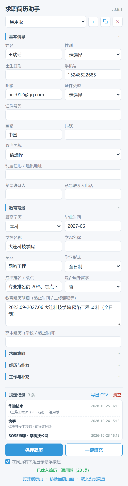
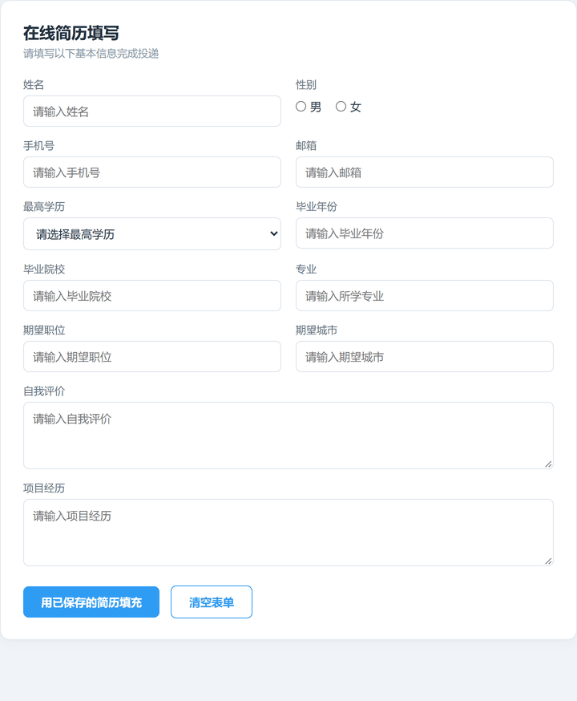
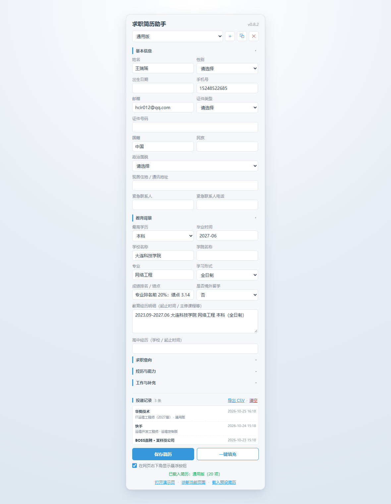
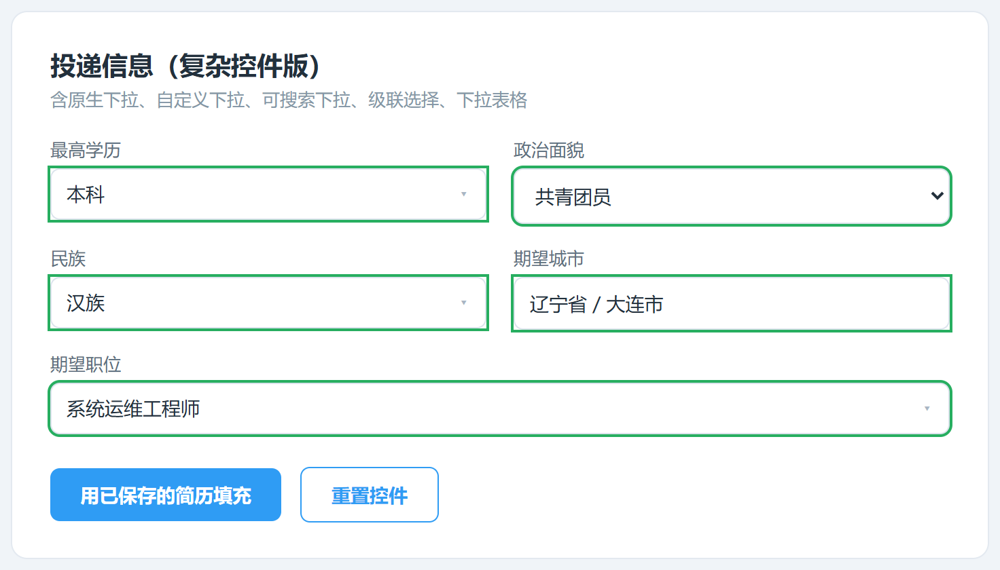
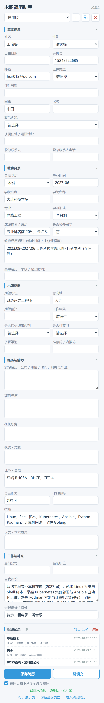

# 求职简历助手（job-helper-extension）

一款纯本地的求职效率 Chrome 插件：中文简历一键填充、多简历版本管理、投递记录台账与 CSV 导出。所有数据保存在浏览器本地（`chrome.storage.local`），不依赖任何云端服务。

> 技术栈：Chrome Extension Manifest V3 · 原生 HTML/CSS/JS · chrome.storage.local

**下载即用**：[最新版本 v0.9.0](https://github.com/Hcir782/job-helper-extension/releases/latest) · 解压后加载即可，不需要 Node / npm / 构建步骤 · [全部版本](https://github.com/Hcir782/job-helper-extension/releases)

| 插件面板（44 字段 / 版本管理 / 投递记录） | 一键填充真实表单 |
| --- | --- |
|  |  |

<p align="center"><sub>右图为插件自带演示页的实际填充过程：绿色描边为命中字段，底部提示本次填充结果</sub></p>


## 功能规划

| 功能 | 状态 |
| --- | --- |
| 插件基础骨架（Manifest V3 + Popup + Content Script） | ✅ 已完成 |
| 简历信息本地存储 + 招聘网页一键填充 | ✅ 已完成（v0.2.0） |
| 模拟招聘表单演示页 + 页面结构诊断 | ✅ 已完成 |
| 动态注入（activeTab + chrome.scripting，任意网站可用） | ✅ 已完成（v0.3.0） |
| 字段别名词典 + 站点/组件库适配器 | ✅ 已完成（v0.3.0） |
| 全网页自动注入 + 悬浮按钮可开关 | ✅ 已完成（v0.4.0） |
| 多简历版本管理（新建 / 切换 / 复制 / 删除） | ✅ 已完成（v0.5.0） |
| 投递记录台账（公司 / 岗位 / 时间 / 简历版本） | ✅ 已完成（v0.6.0） |
| 投递记录导出 CSV（Excel 可直接打开） | ✅ 已完成（v0.6.0） |
| 内置预设简历一键载入（换设备/答辩演示快速就绪） | ✅ 已完成（v0.7.0） |
| 表单字段扩展到 44 项（Moka 华勤 + 快手申请表字段并集去重） | ✅ 已完成（v0.8.0） |
| 表单去掉灰色占位示例文字，空字段保持空白 | ✅ 已完成（v0.8.1） |
| 标签页模式下面板居中显示为卡片（不再贴左上角） | ✅ 已完成（v0.8.2） |
| 自定义下拉 / 可搜索下拉 / 级联选择 / **下拉表格** 填充 | ✅ 已完成（v0.9.0） |

## 支持的招聘网站

**所有网页**。v0.4.0 起 `content_scripts.matches` 与 `host_permissions` 均使用 `<all_urls>`，任意网页打开即注入，右下角出现悬浮按钮。

内置了针对性适配器的站点：

| 类型 | 覆盖 |
| --- | --- |
| 站点适配 | BOSS直聘、猎聘、智联招聘、前程无忧、拉勾 |
| 组件库适配（企业自建招聘系统常用） | Ant Design、Element UI、Arco Design |

未命中任何适配器时，会退回通用启发式规则（label / placeholder / aria-label / 邻近文本）。

> 如果不想让悬浮按钮出现在每个网页，打开面板取消勾选「在网页右下角显示悬浮按钮」即可，已打开的页面会实时隐藏。

## 快速开始（拿到仓库后 3 分钟）

不需要 Node、不需要 `npm install`、不需要构建——这就是一堆可以直接被浏览器加载的静态文件。只有想跑测试时才需要 Node。

### 1. 拿到代码

| 方式 | 操作 | 适合 |
| --- | --- | --- |
| **下载 Release 包（最省事）** | 打开 [最新版本](https://github.com/Hcir782/job-helper-extension/releases/latest)，下载 `job-helper-extension-vX.Y.Z.zip` 并解压 | 只想用插件，不关心 git |
| 下载 ZIP（源码） | 仓库页右上角 **Code → Download ZIP**，解压到任意目录 | 只用插件、不改代码 |
| git clone | `git clone https://github.com/Hcir782/job-helper-extension.git` | 想跟进后续更新、改代码 |

> ⚠️ 解压后文件夹名可能是 `job-helper-extension-main`，这没关系，**只要这一层里有 `manifest.json` 就对**。

### 2. 加载到浏览器

1. Chrome 打开 `chrome://extensions/`，Edge 打开 `edge://extensions/`
2. 打开右上角 **开发者模式**（Developer mode）
3. 点 **加载已解压的扩展程序 / Load unpacked**
4. **选中第 1 步解压出来的那一层文件夹**（含 `manifest.json` 的目录）——不要选里面的 `tests/`、`docs/` 等子目录，也不要选中单个文件
5. 工具栏出现图标即成功，建议点图钉固定到工具栏（快捷键是 `Ctrl + Shift + Y`）

安装时浏览器会提示「读取和更改所有网站数据」，这是 `<all_urls>` 注入悬浮按钮所必需的，插件不会上传任何数据。

### 3. 首次使用

刚装好的面板是**空的**（不会带任何人的数据）。两条路：

- 自己填：打开面板逐项填写 → **保存简历**；
- 想快速看效果：点面板底部 **载入预设简历**，会导入一份示例版本（作者本人的校招信息，含华勤/快手的申请字段），看完在版本下拉框切回「通用版」或把示例版本删掉即可。

填完简历后，**打开招聘网站的职位/申请页并刷新一次**，再点面板的 **一键填充**。想先就地验证，点 **打开演示页** 或直接打开 `demo-widgets.html`。

### 4. 更新到最新版

- ZIP 安装的：重新下载 ZIP 覆盖原文件夹（或解压到新目录后重新加载）
- clone 的：在仓库目录执行 `git pull`
- 然后到 `chrome://extensions/` 点插件卡片上的 **刷新 ↻**，再刷新已打开的网页

面板右上角显示的版本号（如 `v0.9.0`）就是当前生效版本，对不上说明没刷新成功。

### 5. 卸载 / 清空数据

扩展页点 **移除** 即可彻底删除，简历与投递记录都存在扩展自己的 `chrome.storage.local` 里，卸载即消失，不会残留在网页或云端。

### 装不上时的排查

| 现象 | 原因 | 解决 |
| --- | --- | --- |
| 提示「清单文件缺失或不可读取」 | 选错了目录层级 | 重选，确保那一层能直接看到 `manifest.json` |
| 加载成功但网页上没有红色 `fill` 按钮 | 页面是安装前就打开的 | 刷新页面；还不行就在扩展页点 ↻ 后重启浏览器 |
| 点填充提示「页面未响应」 | content script 未注入（旧标签页/受限页面） | 刷新页面；`chrome://` 开头的系统页无法注入，属正常 |
| 版本号一直是旧版 | 改了代码但没重载扩展 | `chrome://extensions/` 点插件卡片的刷新按钮 |

## 使用教程

### 三种打开面板的方式

| 方式 | 操作 |
| --- | --- |
| 工具栏图标 | 点击插件图标（需先钉到工具栏） |
| 快捷键 | `Ctrl + Shift + Y` |
| 页面悬浮按钮 | 招聘页右下角红色圆形 `fill` 按钮 |

前两种是浏览器弹窗，尺寸紧凑；后一种会在新标签页里打开面板，此时面板居中显示为一张卡片（v0.8.2 起），整页自然滚动，字段看得更全：



### 一键填充

1. 点击插件图标打开面板，填写姓名、手机号、学历、毕业院校、期望职位等字段
2. 点击 **保存简历**，数据存入浏览器本地
3. 打开招聘网站的简历填写页或申请表单页，刷新一次页面
4. 回到面板点击 **一键填充**，页面中匹配到的输入框会以绿色描边闪一下
5. 面板底部提示本次填充结果，例如「已填充 8 个字段，3 个未匹配」

### 演示页

面板底部点击 **打开演示页**，会打开插件自带的模拟招聘申请表，用于验证填充引擎是否正常，不依赖任何真实网站，也不受网站改版影响。

### 页面诊断

在招聘页面点击面板底部 **诊断当前页面**，会列出页面上的候选控件（类型、周边文案、name/id）。字段匹配异常时用它定位原因。诊断结果里出现「**自定义下拉**」条目，说明插件认出了这类控件；如果填不上，通常是选项文案对不上（见下一节）。

### 下拉表格 / 自定义下拉（v0.9.0）

很多校招系统（Moka、快手自建、企业自研后台）的下拉**不是**原生 `<select>`：页面上是一个 `div`，点开后才把选项渲染到 `body` 末尾的浮层里，有的还是**表格**（一行一个岗位、一行一个部门），选完要再点「确定」。这类控件以前只能算「未匹配」，现在插件会**模拟真实点击**去填：

| 形态 | 典型长相 | 插件怎么填 |
| --- | --- | --- |
| 普通自定义下拉 | Ant Design `Select`、Element `Select` | 点开 → 在浮层里按文案找选项 → 点中 |
| 可搜索下拉 | 触发器本身是个搜索框（如「民族」） | 先按文案找；找不到就把值打进搜索框，等组件自己过滤后再选一次 |
| 级联选择 | 省 → 市、部门 → 小组 | 值按 `/`、`>`、`、` 或连续空格拆段，逐级点下去（如「辽宁省 / 大连市」） |
| **下拉表格** | 浮层里是 `<table>`，一行一个选项，底部有「确定」 | 按文案找到对应 `<tr>` → 点行内 radio/整行 → 点「确定」 |

匹配规则（`lib/option-match.js`）：

- 忽略空格（含全角空格）、忽略括号补充说明、不区分大小写：「CET-4（520 分）」能匹配选项「CET-4」
- 完全相等 > 选项包含值（「本科（全日制）」←「本科」）> 值包含选项（「RHCSA、RHCE；CET-4」→「RHCE」）
- **歧义宁可不动**：一个值同时像多个选项时（比如证书字段同时含 RHCSA 和 RHCE），不替用户瞎选，留空让他手动点
- 每个控件独立超时，失败静默跳过并计入「未匹配」，不会卡住整轮填充；全部自定义控件共享 4 秒总预算

想自己验证：打开 `demo-widgets.html`（模拟 Ant Design 下拉、可搜索下拉、省级联、职位下拉表格），点「用已保存的简历填充」，四个控件应全部填上。



<sub>上图为实测：原生下拉「共青团员」、自定义下拉「本科」、可搜索下拉「汉族」、省级联「辽宁省 / 大连市」、职位下拉表格「系统运维工程师」一次填完，绿色描边为命中提示。</sub>

### 多简历版本管理

面板顶部的版本工具栏可以管理多份简历：

| 操作 | 说明 |
| --- | --- |
| 切换版本 | 下拉框选择，切换时如有未保存修改会弹窗询问是否保存 |
| 新建版本（＋） | 创建一份空白简历，适合「通用版 / 运维定制版 / 前端定制版」分场景投递 |
| 复制版本（⧉） | 把当前版本复制一份再改，不用从零填写 |
| 删除版本（✕） | 删除当前版本，自动切换到剩余版本；至少保留一个 |

保存和一键填充始终作用于**当前选中的版本**。

### 投递记录与 CSV 导出

- 打开内置适配的招聘站点（BOSS直聘 / 猎聘 / 智联 / 前程无忧 / 拉勾）职位页时，插件自动从页面标题提取**公司 + 岗位**登记到台账；在页面执行过一次一键填充也会登记。
- 每条记录包含：公司、岗位、投递时间、当时使用的简历版本、页面链接。
- **自动去重**：同公司 + 同岗位 + 同一天只记一条，反复刷新页面不会刷屏。
- 面板底部「投递记录」区展示最近 50 条，点 **导出 CSV** 可下载完整台账（带 BOM，Excel 直接打开中文不乱码），点 **清空** 可全部删除。

### 载入预设简历

面板底部点击 **载入预设简历**，会把 `presets/resume-wangruiyao.json` 里预置的完整简历导入为一个**新版本**（不覆盖已有数据），并自动切换到该版本。

用途：
- 换电脑、换浏览器后快速恢复一份可用数据，不用从零手动填写
- 答辩/演示时一键准备完整数据，避免现场打字

预设文件是普通 JSON，可以按同样格式放自己的版本，文件名需要在 `popup.js` 的 `loadPresetResume()` 里对应修改。空字段会保持为空，不会瞎填。

### 答辩 / 汇报演示流程（约 5 分钟）

按下面的顺序演示，全程不依赖外网，也不怕招聘网站改版：

| 步骤 | 操作 | 讲解要点 |
| --- | --- | --- |
| 0 · 准备 | `chrome://extensions/` 加载插件 → 打开面板 → 点 **载入预设简历** | 数据一键就绪，不用现场打字 |
| 1 · 版本管理 | 面板顶部下拉框切换 / 点 ＋ 新建 / ⧉ 复制 | 一份简历按岗位分版本投递，切换时提示保存 |
| 2 · 一键填充 | 点 **打开演示页** → 在演示页点「用已保存的简历填充」 | 命中字段绿色描边，底部输出「已填充 N 个字段」 |
| 2.5 · 复杂控件 | 打开 `demo-widgets.html` → 点「用已保存的简历填充」 | 普通下拉 / 可搜索下拉 / 省级联 / **下拉表格** 四种形态一次填完，体现「模拟点击 + 选项匹配」 |
| 3 · 真实网页 | 打开任意招聘职位页，右下角红色 `fill` 按钮 | 悬浮入口 + 全网页注入（`<all_urls>`） |
| 4 · 投递记录 | 回到面板看「投递记录」→ 点 **导出 CSV** | 自动登记公司/岗位/版本，CSV 带 BOM，Excel 直接打开 |
| 5 · 技术要点 | 讲「动态注入 / 别名词典 / React 受控组件适配 / 伪下拉模拟点击 / 单一数据源」 | 见下方「技术要点」章节 |

### 常见问题（FAQ）

**Q：点了网页右下角的 `fill` 悬浮按钮没反应？**
A：先刷新页面。仍不行说明 content script 是旧版本，在 `chrome://extensions/` 点插件的刷新按钮，然后重新加载网页。若 background 正在休眠，v0.6.1 起会自动降级为新标签页直接打开面板。

**Q：填充后提示「N 个字段未匹配」怎么办？**
A：说明页面上没有对应输入框，或该字段用的是日期控件等尚未支持的形态。点面板底部 **诊断当前页面**：若列表里能看到「自定义下拉」条目，说明控件认出来了但选项没匹配上（多半是选项文案和简历里的值对不上，改简历里的写法最省事）；若连条目都没有，说明该控件渲染在 Shadow DOM / 跨域 iframe 里，插件读不到。

**Q：下拉表格（点开是一张表格的选项）能填吗？**
A：能（v0.9.0）。插件会模拟点击打开浮层，按文案在表格里找到对应行、点中行的单选按钮，再点「确定」。想验证就用 `demo-widgets.html`。注意：选完之后如果页面还要「保存草稿」才生效，那一步仍需手动点。

**Q：数据存在哪里？换电脑怎么迁移？**
A：全部存在浏览器本地的 `chrome.storage.local`，不联网、不上传。迁移时把 `presets/resume-wangruiyao.json` 按同样格式改好，在新环境点 **载入预设简历** 即可；也可用投递记录里的 **导出 CSV** 备份台账。

**Q：为什么安装时提示「读取和更改所有网站数据」？**
A：因为要在所有网页提供悬浮入口和按需注入（`<all_urls>`）。插件不发起任何数据上传，唯一的网络请求是读取本地 `presets` 文件。

**Q：保存了简历但填充还是旧内容？**
A：填充始终作用于**当前选中的版本**。确认下拉框里选的是你要投的那一版；另外页面需要刷新一次才能拿到最新注入的脚本。

### 字段清单（44 项，5 组可折叠）



面板表单字段是把两个真实校招申请表的字段做**并集去重**得到的：

- 华勤技术（Moka ATS）：`app.mokahr.com/campus-recruitment/hq/*`
- 快手校招：`campus.kuaishou.cn/recruit/campus/e/`

| 分组 | 字段 |
| --- | --- |
| 基本信息（13） | 姓名、性别、出生日期、手机号、邮箱、证件类型、证件号码、国籍、民族、政治面貌、现居住地/通讯地址、紧急联系人、紧急联系人电话 |
| 教育背景（10） | 最高学历、毕业时间、学校名称、学院名称、专业、学习形式、成绩排名/绩点、是否境外留学、教育经历明细、高中经历 |
| 求职意向（8） | 期望职位、意向城市、期望薪资、工作年限、是否接受城市调剂、是否可实习、了解渠道、推荐码/内推码 |
| 经历与能力（9） | 实习经历、项目经历、在校职务、获奖/竞赛、证书/资格、语言能力、作品链接、技能、论文/学术成果 |
| 工作与补充（4） | 当前公司、当前职位、自我评价、兴趣爱好/特长 |

**合并规则**（重复字段只保留一个）：

| 两个表单里的叫法 | 合并后字段 |
| --- | --- |
| 现居住地 / 现在居住城市 / 通讯地址 | `address` |
| 意向工作城市 / 意向地点 | `expectCity` |
| 自我描述 / 自我评价 | `selfIntro` |
| 就读时间（起止） | 并入 `eduDetail` |
| 获奖经历 / 竞赛获奖 / 荣誉 | `awards` |
| 技能证书 / 证书种类 / 证书名称 | `certificates` |
| 上传简历（附件） | 不做字段——插件不处理文件上传 |

列表型经历（教育 / 实习 / 项目 / 获奖 / 在校职务 / 证书）用**一个多行文本框**承载整段文字，填充时整体写入对应的输入框或富文本编辑器。

字段定义是**单一数据源**：`field-dictionary.js` 的 `JH_FIELD_GROUPS`，面板表单、别名词典、预设 JSON 三处都从它派生；`tests/integration-smoke.test.js` 会断言 `popup.html` 的控件与词典字段**数量和顺序完全一致**，防止以后增删字段时漏改。

## 目录结构

```
job-helper-extension/
├─ manifest.json         # Manifest V3 配置：权限、popup、options、background、content script 注入规则
├─ background.js         # Service Worker：面板标签管理、按需动态注入、请求转发、投递记录写入
├─ field-dictionary.js   # 字段别名词典 + 字段分组（44 字段 × 多别名，全项目单一数据源）
├─ site-adapters.js      # 站点 / 组件库适配器注册表 + 招聘站点域名表 + 页面公司/岗位探测
├─ content.js            # 注入网页：字段识别、表单填充、注入徽标、悬浮入口、页面诊断、投递登记
├─ popup.html            # 面板（5 组可折叠表单，同时注册为"扩展程序选项"）
├─ popup.js              # 面板交互：简历版本管理、简历读写、一键填充、投递记录、CSV 导出、预设载入
├─ popup.css             # 面板与表单样式
├─ lib/ledger.js         # 投递记录台账核心逻辑（去重 / CSV / 格式化），三端共享的纯函数库
├─ lib/option-match.js   # 下拉选项匹配纯函数（归一化 / 打分 / 选优 / 拆级联 / 选表格行），content + Node 单测共用
├─ presets/
│  └─ resume-wangruiyao.json  # 内置预设简历（44 字段 + 来源信息）
├─ demo.html             # 模拟招聘申请表演示页（原生控件）
├─ demo.js               # 演示页逻辑，复用同一套填充引擎
├─ demo-widgets.html     # 复杂控件演示页（Ant 下拉 / 可搜索下拉 / 省级联 / 职位下拉表格）
├─ demo-widgets.js       # 复杂控件演示页的假组件实现（浮层渲染到 body 末尾，贴近真实框架）
├─ docs/                 # README 用的演示素材（面板截图、字段全貌、标签页居中、填充动图）
├─ CHANGELOG.md          # 版本更新日志（v0.1.0 → 当前版本）
├─ tests/
│  ├─ popup-version.test.js     # 简历版本管理 13 条断言
│  ├─ ledger.test.js            # 投递记录去重 / CSV / 页面探测 20 条断言
│  ├─ option-match.test.js      # 下拉选项匹配算法 22 条断言（纯函数，无需浏览器）
│  ├─ integration-smoke.test.js # 集成冒烟：SW 消息链 + 面板加载 + 预设导入 + 字段一致性 7 条断言
│  └─ e2e-widgets.js            # 端到端：真实浏览器里填 4 种自定义控件（需 Edge + puppeteer-core，缺则跳过）
└─ .gitignore            # 忽略编辑器缓存、日志、系统垃圾文件
```

运行测试：

```bash
node tests/popup-version.test.js     # 13/13 通过
node tests/ledger.test.js            # 20/20 通过
node tests/option-match.test.js      # 22/22 通过
node tests/integration-smoke.test.js # 7/7 通过
node tests/e2e-widgets.js            # 11/11 通过（需 Edge，缺环境自动跳过）
```

前四套共 **62 条断言**不依赖浏览器：用 `vm` 沙箱加载真实脚本、mock 掉 `chrome.*` 与 DOM，所以能在提交前就发现「按钮没绑定事件」「字段与词典不一致」这类问题。最后一套 `e2e-widgets.js` 必须真浏览器——伪下拉的核心是「点击 → 等框架异步渲染 → 点选项」，mock DOM 测不出这个时序。版本历史见 [CHANGELOG.md](CHANGELOG.md)。

## 技术要点

- **按需动态注入**：manifest 对所有网页声明静态注入；页面未响应时，由 `background.js` 调用 `chrome.scripting.executeScript`（配合 `activeTab` 权限）现场注入，因此**任何招聘网站都能用**，也避免了枚举域名的漏配问题。
- **字段别名词典**：44 个字段各自维护一份别名表（如手机号 ← 手机号/联系电话/联系方式/移动电话/phone…），命中别名越长得分越高。
- **站点适配器**：为 5 个招聘站点和 3 个常用前端组件库分别声明"字段容器选择器 + 文案选择器"，先定位结构再取文案，比纯关键词匹配稳得多。
- **React 受控组件适配**：Boss 直聘等站点使用 React，直接 `el.value = x` 会被框架内部状态覆盖。本项目改为调用原型链上的原生 `value` setter，再派发 `input` / `change` / `blur` 事件，框架才能感知变化。
- **中文 label 去空白匹配**：招聘站点的 label 常写成「姓　名」「手 机 号」，匹配前统一去除空白。
- **防误填**：英文关键词在 `name` / `id` 属性中要求边界匹配，避免 `companyName` 被识别成「姓名」；中文关键词只匹配可见文案，避免被 class 名干扰。
- **富文本支持**：`contenteditable` 编辑器通过 `execCommand('insertText')` 写入，适配 Vue/React 富文本组件。
- **伪下拉（自定义下拉 / 下拉表格）**：这类控件 DOM 里没有 `<select>`，选项要点开后由框架异步渲染到 `body` 末尾。做法是模拟 `mousedown → mouseup → click` 完整手势（很多组件只认这个序列），轮询 12 × 50ms 等浮层出现，再在浮层里找 `role="option"` / `li` / `tbody tr` 并按文案匹配点击；选完点「确定」、失败点空白处收起。匹配算法抽成 `lib/option-match.js` 纯函数（归一化 / 打分 / 选优 / 拆级联 / 选行），既能在 content script 用，也能被 Node 单测直接 require。
- 因此填充主流程改成了 **async**：`fillResume()` 返回 Promise，content script 里必须 `return true` 保持消息通道，否则 popup 会先拿到 `undefined`。
- **投递记录去重**：`lib/ledger.js` 以「公司 + 岗位 + 同自然日」为去重键，content 侧同 URL 只报一次、background 侧再去重一次，双保险。
- **页面信息探测**：从 `og:title` / `document.title` 切段提取公司名与岗位名，兼容「公司_岗位_站点」「岗位_公司_站点」「公司+岗位同段」等常见 title 格式；公司名分强弱两级后缀匹配，防止「科技有限公司」被「科技」截断。
- **CSV 导出**：带 BOM（Excel 中文不乱码），字段含逗号/引号/换行时按 RFC 4180 加双引号转义。

## 权限说明

| 权限 | 用途 |
| --- | --- |
| `storage` | 简历数据与投递记录保存在浏览器本地 |
| `activeTab` | 用户点击插件图标/快捷键时，获得当前标签页的一次性访问权 |
| `scripting` | 页面未注入脚本时按需动态注入 |
| `<all_urls>`（host） | 让内容脚本能在所有网页运行，从而在任意招聘站点提供悬浮入口 |

插件不上传任何数据：简历内容只在本地存储与本地页面之间流转，唯一的网络请求是插件自己检查更新的 GitHub Release 查询（未启用时可删除）。

## 已知限制

- **Boss 直聘在线简历页**是「卡片展示 + 点击弹出编辑」的结构，页面上几乎没有 `input`，一键填充在该页面无字段可填。这类页面需要专门的「点开编辑器再填充」适配，尚未实现。
- **自定义下拉已支持（v0.9.0）但有边界**：需要选项浮层带常见的类名 / ARIA 角色（`role="option"`、`ant-select-dropdown`、`el-select-dropdown` 等）。如果站点把选项渲染在 **Shadow DOM** 或 **跨域 iframe** 里，插件读不到，会记为「未匹配」。
- **日期选择器**（日历弹层、年月分离控件）仍未支持：Moka / 快手把出生日期、起止时间拆成「年」「月」两个下拉，无法自动拆分填写，需要手动补选。
- **下拉里的「搜索 + 远程加载」**：极少数下拉要把关键词传给服务器才返回选项，插件打了字但列表还没回来，会超时跳过。
- **附件上传类字段不处理**：Moka/快手的「上传简历」需要文件选择，插件只填文本，不代传文件。
- **投递记录只在 5 个内置适配的招聘站点自动登记**（BOSS直聘 / 猎聘 / 智联 / 前程无忧 / 拉勾），其他网页不登记——这是刻意为之，避免在无关网页产生噪音记录、也减少隐私顾虑。未识别出公司/岗位时仍会记录 URL，显示为「未知公司/未知岗位」。
- 使用 `<all_urls>` 权限后，扩展详情页会显示"读取和更改所有网站数据"，这是为了在所有网页提供悬浮入口所必需的。

## 设计原则

- **本地优先**：简历与投递数据只存浏览器本地，不接入云端 API，隐私可控、无网络依赖。
- **小步迭代**：每个功能开发完成并实测通过后单独提交，遵循 `feat:` / `fix:` 提交规范。

## License

MIT License

## 致谢

本项目的字段别名词典与站点适配器结构，参考了以下开源项目：

- [OpenJobAutofill](https://github.com/Br1an67/OpenJobAutofill)（MIT License, Copyright (c) 2026 Br1an67）——字段别名表的整理思路与站点适配器设计
